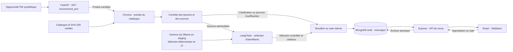

# Next-BH · État d’avancement au 20 novembre 2026

Les vagues 1 et 2 sont terminées dans Jira. La vague 3 est intégrée à `master` pour le pilote synthétique de recommandation d’assurances à des entreprises. Les contrôles en CI ont reproduit les 24 résultats attendus. La recette avec le modèle `gemma3n:e4b` et l’évaluation humaine restent en attente. [Jalon BH-12](https://maiteai.atlassian.net/browse/BH-12), [recette BH-16](https://maiteai.atlassian.net/browse/BH-16)

## Livraisons et traçabilité

| Étape | Travail livré | Jira et GitHub |
| --- | --- | --- |
| Mise en place | Organisation de l’équipe et circuit de suivi Jira → branche → PR → validation. | [BH-1](https://maiteai.atlassian.net/browse/BH-1) (Done) |
| Vague 1 · Démonstration reproductible | Contrat de l’API sur données synthétiques, création d’un brouillon initial en attente, commande de démonstration et guide depuis un clone propre. | [BH-2](https://maiteai.atlassian.net/browse/BH-2) (Done), [BH-3 → PR #1](https://github.com/naderite/Next-BH/pull/1), [BH-4 → PR #2](https://github.com/naderite/Next-BH/pull/2), [BH-5 → PR #3](https://github.com/naderite/Next-BH/pull/3), [BH-6 → PR #4](https://github.com/naderite/Next-BH/pull/4) |
| Vague 2 · Revue humaine | Export du tableau de bord historique, écriture atomique des décisions, approbation et rejet dans le navigateur, vérifications en CI. | [BH-7](https://maiteai.atlassian.net/browse/BH-7) (Done), [BH-8 → PR #7](https://github.com/naderite/Next-BH/pull/7), [BH-9 → PR #5](https://github.com/naderite/Next-BH/pull/5), [BH-10 → PR #8](https://github.com/naderite/Next-BH/pull/8), [BH-11 → PR #6](https://github.com/naderite/Next-BH/pull/6) |
| Vague 3 · Recommandation avec sources | Parcours PM, catalogue synthétique approuvé pour le pilote, récupération dans Chroma, contrôle des sources et affichage des brouillons générés. | [BH-12](https://maiteai.atlassian.net/browse/BH-12) (In Progress), [BH-13 → PR #10](https://github.com/naderite/Next-BH/pull/10), [BH-14 → PR #9](https://github.com/naderite/Next-BH/pull/9), [BH-15 → PR #11](https://github.com/naderite/Next-BH/pull/11) |
| Vague 3 · Recette et preuves | Lanceur, contrôle de bout en bout, guide de recette et grille. L’implémentation a été fusionnée. La recette Gemma et la notation restent en attente. | [BH-16](https://maiteai.atlassian.net/browse/BH-16) (In Progress, recette en pause), [PR #12](https://github.com/naderite/Next-BH/pull/12) |
| Fiabilisation | Restauration des métadonnées Git du tableau de bord, actions GitHub sur Node 24, fins de ligne LF pour les scripts Bash du pilote et les correctifs. Le runtime applicatif de CI reste Node 22. | [BH-17](https://maiteai.atlassian.net/browse/BH-17) (Done), [PR #13](https://github.com/naderite/Next-BH/pull/13) |

Les PR #1 à #13 étaient fusionnées dans `master` au point de référence `4bfca3682be42a1f52011a7111d648ed9f83553e`. Jira conserve le détail des revues et des critères d’acceptation. La revue technique et la fusion des PR #11 à #13 ont été effectuées sous la direction de Mohamed Kallel. La notation humaine du pilote reste à consigner. [Commit de référence](https://github.com/naderite/Next-BH/commit/4bfca3682be42a1f52011a7111d648ed9f83553e), [revue BH-16](https://maiteai.atlassian.net/browse/BH-16)

## Partie de l’architecture couverte

Le pilote part d’une opportunité d’assurance pour une personne morale (PM) et se termine par l’enregistrement d’une décision de revue interne.

| Couche | Implémentation et rôle |
| --- | --- |
| Données et API | [Cas](../scripts/fixtures/wave3-opportunities.json) et [catalogue](../scripts/fixtures/wave3-catalog.json) fictifs. [Adaptateur du pilote](../scripts/staging_inputs.py) et [route FastAPI](../api_datasets/app.py). Le pilote soumet des données temporaires à la route existante dans le processus Python et récupère le produit candidat. Les adresses de contact sont remplacées par des valeurs sous `example.invalid`. |
| Récupération des passages | Chroma embarqué dans le pilote, avec des vecteurs lexicaux normalisés et un filtre par nom exact du produit candidat. Le [catalogue approuvé](STAGING_PILOT.md#pin-the-inputs) est contrôlé par SHA-256. [Indexation et recherche](../scripts/staging_inputs.py) |
| Recommandation | Le scénario [LangChain](../agent/utils/recommendation_chain.py) choisit des identifiants de sources que le [contrôle Python](../agent/utils/grounded_recommendation.py) valide. Le code forme le brouillon à partir des citations vérifiées. Il produit une note interne si les besoins sont indéterminés, les preuves insuffisantes ou la sélection du modèle invalide. |
| Persistance | Le [lanceur Python](../scripts/run_staging_recommendations.py) enregistre le brouillon `pending`, le cas, les citations, la révision du catalogue et les métadonnées du modèle dans la collection `messages` d’un MongoDB jetable. |
| Revue | Les [deux correctifs du tableau de bord](../web/review-pilot/) ajoutent l’entrée Express isolée et l’écran React **Validation**. Une décision passe de `pending` à `validated` ou `rejected`. L’auteur de la décision et l’horodatage UTC sont persistés dans le même document. Une deuxième décision renvoie HTTP 409. La vague 2 couvre aussi le chemin [Python → MongoDB](../agent/utils/draft_review.py). |
| Exécution | Le [lanceur Bash](../scripts/run_dashboard_review_pilot.sh) exporte la révision historique `a18e1e0fc402af64d63a16fba5532bc357d077e1` et applique `dashboard.patch` puis `staging.patch` en mode vague 3. Le gitlink reste sur `394df01b2ce3fb5575a828049928885c76f3c31a`, indisponible dans le dépôt source. [Provenance du tableau de bord](DASHBOARD_SOURCE.md) |

Les [schémas historiques](../Readme.md#system-architecture) décrivent la plateforme au sens large. Le pilote démarre uniquement les composants nécessaires à la recommandation et à la revue. L’envoi client, la messagerie entrante, Kafka, les parcours de facturation et de renouvellement, les particuliers et l’apprentissage par renforcement restent hors de cette recette. Le plan académique historique d’assurance habitation pour particuliers et de politique MaskablePPO entraînée relève d’un autre périmètre.

## Tests et preuves reproductibles

| Vérification | Résultat observé | Preuve |
| --- | --- | --- |
| API, brouillon, décisions et tableau de bord synthétique | Deux jobs réussis. Le contrat API, les deux décisions et leur persistance après actualisation sont couverts. | [CI Synthetic draft review sur `4bfca36`](https://github.com/naderite/Next-BH/actions/runs/44643141682), [guide de reproduction](DRAFT_REVIEW_DEMO.md) |
| Recommandation et revue de bout en bout | FastAPI, Chroma, MongoDB et Chromium exécutés avec réponses de modèle déterministes. 24/24 résultats attendus, dont 8 recommandations, 8 demandes de clarification et 8 cas de preuves insuffisantes. | [CI vague 3 sur `4bfca36`, tentative 2](https://github.com/naderite/Next-BH/actions/runs/44643141739/attempts/2), [jeu de cas et critères](STAGING_EVALUATION.md) |
| Décisions, accès et absence d’envoi | Le test navigateur vérifie les citations, le refus d’accès sans connexion (401), les deux décisions et leurs métadonnées après rechargement, les conflits (409), les notes d’abstention, l’absence de route d’envoi (404) et l’absence de requête navigateur hors origine. Le bilan rapporte zéro message client. | [Test Chromium](../scripts/check_dashboard_review.cjs), [job et journaux du pilote](https://github.com/naderite/Next-BH/actions/runs/44643141739/job/135981926388) |
| Reproduction Git/Bash sur Windows | Export historique et application successive des deux correctifs vérifiés depuis `master`. Une vérification en checkout propre a également contrôlé l’énumération du sous-module et la syntaxe des scripts Bash. | [BH-17](https://maiteai.atlassian.net/browse/BH-17), [PR #13](https://github.com/naderite/Next-BH/pull/13) |
| Recette Gemma et notation | En attente du modèle et d’un hôte adapté, puis de la revue humaine. Les captures de cette recette restent à produire. | [BH-16](https://maiteai.atlassian.net/browse/BH-16), [guide et commandes](STAGING_PILOT.md), [grille](STAGING_EVALUATION.md#human-scoring) |

La première tentative de CI vague 3 sur `4bfca36` a été annulée pendant l’installation de Chromium et la préparation de MongoDB. La deuxième a réussi sur le même commit. Les avertissements sur les métadonnées du sous-module et le runtime Node des actions ont disparu des exécutions réussies contrôlées après BH-17. [Tentative 1](https://github.com/naderite/Next-BH/actions/runs/44643141739/attempts/1), [BH-17](https://maiteai.atlassian.net/browse/BH-17)

## Travaux restants

1. Mettre à disposition un hôte Linux avec assez de ressources pour le modèle et le tableau de bord isolé. Le poste Windows vérifié manquait d’espace disque. Aucun environnement Next-BH n’était disponible sur le compte Codex Cloud consulté. Les preuves de CI proviennent de GitHub Actions. [BH-16](https://maiteai.atlassian.net/browse/BH-16), [prérequis](STAGING_SETUP.md)
2. Exécuter la recette depuis un `master` propre avec Ollama, `gemma3n:e4b` et le catalogue approuvé. Archiver le commit, les commandes, la version Ollama, les empreintes du modèle et du catalogue, et les résultats attendus et observés par cas. Relever les écarts éventuels. [Procédure de recette](STAGING_PILOT.md)
3. Consigner les preuves du tableau de bord avant de supprimer la base jetable. Ouvrir `CLEAR-01` et `CLEAR-02`, vérifier leurs sources, approuver un brouillon et rejeter l’autre, puis vérifier les auteurs et horodatages après rechargement. Contrôler `AMBIG-01`, `NOFIT-08` et les preuves d’absence d’envoi. [Procédure de revue](STAGING_PILOT.md#run-and-review)
4. Faire noter les 24 cas par Mohamed Kallel ou un autre évaluateur autorisé. Pour chaque cas, consigner la décision et les notes de 0 à 2 sur la pertinence, l’appui sur les sources et l’utilisabilité. Renseigner les totaux sur 48 par dimension, la date, l’évaluateur et un commentaire pour chaque note inférieure à 2. Publier ces preuves dans Jira puis clôturer BH-16 et BH-12 après satisfaction de leurs critères. [Grille de notation](STAGING_EVALUATION.md#human-scoring), [critères du jalon](https://maiteai.atlassian.net/browse/BH-12)

Pour produire le document destiné à l’encadrement, utiliser le [prompt de rédaction et de collecte des captures](PROMPT_RAPPORT_AVANCEMENT.md).
